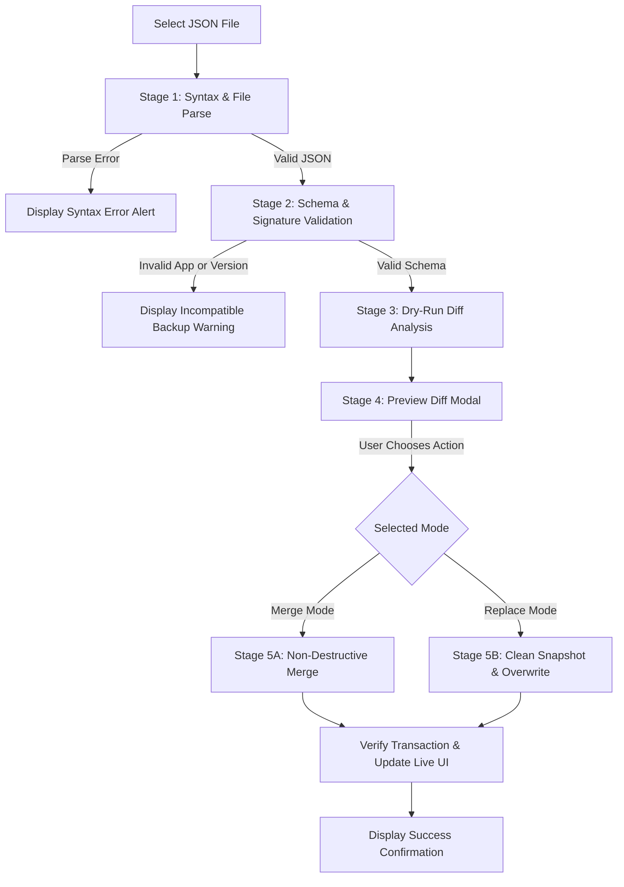

# AK67 — Backup, Portability and Recovery Specification

This document details the architecture, JSON schema, validation rules, conflict resolution mechanisms, and safety safeguards for data backup and restoration in **AK67 — Your Placement Preparation System**.

---

## ⚠️ The Storage Reality & Why Backups Are Mandatory

Because AK67 is a **zero-cost, zero-backend, client-first application**, all user progress is stored exclusively in the browser's **IndexedDB**. 

### Storage Risks Every User Must Understand:
1. **Device Independence**: Devices do **NOT** automatically sync via the cloud. Progress made on a laptop will not automatically appear on a mobile phone unless transferred via a backup file.
2. **Browser Data Clearing**: Using "Clear Browsing Data" or "Clear Cookies and Site Data" in Chrome/Edge/Firefox wipes IndexedDB.
3. **Private / Incognito Browsing**: Incognito windows use temporary storage that is destroyed as soon as the window closes.
4. **Device Damage or Loss**: If a phone or laptop is lost or damaged without an exported backup, progress cannot be recovered from any server.

---

## 📄 Backup File Format Specification (Format v1)

- **File Name Pattern**: `AK67_Backup_YYYY-MM-DD_HHmmss.json` (e.g., `AK67_Backup_2026-11-18_160530.json`)
- **MIME Type**: `application/json`
- **Encoding**: UTF-8

### Structure & Implemented Payload

```json
{
  "appName": "AK67",
  "appVersion": "1.0.0",
  "schemaVersion": 1,
  "backupFormatVersion": 1,
  "exportedAt": "2026-11-18T16:05:30.123Z",
  "summary": {
    "totalProblemsTracked": 67,
    "solvedCount": 24,
    "attemptedCount": 8,
    "totalTopicsTracked": 14,
    "dailyPlannerCount": 10,
    "totalNotes": 12,
    "mistakesCount": 3,
    "mockTestsCount": 3,
    "studySessionsCount": 19,
    "companyProfilesCount": 4
  },
  "data": {
    "problem_progress": [],
    "topic_progress": [],
    "daily_planner": [],
    "mock_tests": [],
    "company_profiles": [],
    "notes": [],
    "study_sessions": [],
    "app_settings": []
  }
}
```

---

## 🛡️ Implemented Restoration Pipeline



### 1. `backupValidator` ([src/services/backup/backupValidator.ts](file:///d:/Projects/AK67/src/services/backup/backupValidator.ts))
- Validates `appName === 'AK67'`.
- Validates `schemaVersion <= 1` and `backupFormatVersion <= 1`.
- Verifies that `data` contains expected array containers.
- Validates essential primary keys (`id` for problems and notes).
- Sanitizes and normalizes missing table arrays defensively.

### 2. `backupDiff` ([src/services/backup/backupDiff.ts](file:///d:/Projects/AK67/src/services/backup/backupDiff.ts))
- Runs dry-run comparison between incoming records and existing IndexedDB records.
- Computes counts: `totalNewRecords`, `totalConflictingRecords`, `totalIdenticalRecords`.
- Produces table-by-table breakdown for user inspection.

### 3. `backupEngine` ([src/services/backup/backupEngine.ts](file:///d:/Projects/AK67/src/services/backup/backupEngine.ts))
- **`generateExport(database)`**: Creates timestamped snapshot and updates `last_backup_timestamp`.
- **`downloadBackup(database)`**: Triggers browser file download with formatted date in filename.
- **`restoreMerge(backupFile, database)`**:
  - Adds new records.
  - Safe conflict resolution:
    - `solved` status wins over `attempted` or `not_started`.
    - Preserves local notes or appends restored notes if distinct.
    - Unions completed topic checkpoints and checklist items.
  - Transactional commit across all 8 tables.
- **`restoreReplace(backupFile, database)`**:
  - Takes in-memory snapshot before wipe.
  - Transactionally clears tables and bulk inserts backup records.
  - Automatically restores previous state if an error occurs.

---

## 🔔 Automated Backup Reminder System

Implemented via [src/hooks/useBackupReminder.ts](file:///d:/Projects/AK67/src/hooks/useBackupReminder.ts) and [src/components/backup/BackupReminderBanner.tsx](file:///d:/Projects/AK67/src/components/backup/BackupReminderBanner.tsx):

- **Trigger Conditions**:
  - $\ge 3$ days have passed since `last_backup_timestamp`, OR
  - User has solved $\ge 3$ problems without creating a backup.
- **Non-Intrusive**: Dismissible for 2 days; never blocks normal app navigation.
- **1-Click Download**: Embedded directly in the reminder banner.

---

## 📱 PWA Offline Backup & Strict IndexedDB Isolation

### 1. IndexedDB Isolation Guarantee
Under the Progressive Web App architecture implemented in Phase 8:
- **Workbox Service Worker Boundary**: The service worker manages cache storage (`CacheStorage` API) strictly for static application code (HTML, CSS, JS bundles, Web fonts, brand icons).
- **Zero IndexedDB Access**: Workbox service workers do **not** intercept, inspect, or manage IndexedDB.
- **Persistence Across SW Updates**: When a new service worker version activates or when outdated caches are purged (`cleanupOutdatedCaches: true`), the browser's IndexedDB database (`AK67_Database`) remains **100% untouched and preserved**.

### 2. 100% Offline Backup Export & Restoration
Backup and restore operations do not require internet access:
- **Offline Export**: The JSON serializer queries IndexedDB directly on the client, constructs a serialized `Blob`, generates an in-memory `URL.createObjectURL(blob)`, and triggers an instant download without making any network requests.
- **Offline Import & Diff**: The backup file is parsed locally using the browser's `FileReader` API. Schema validation, dry-run diff analysis against live IndexedDB data, and the interactive comparison modal execute completely offline.
- **Offline Commit**: Both `restoreMerge` and `restoreReplace` operate within local Dexie.js ACID transactions directly on the device.
