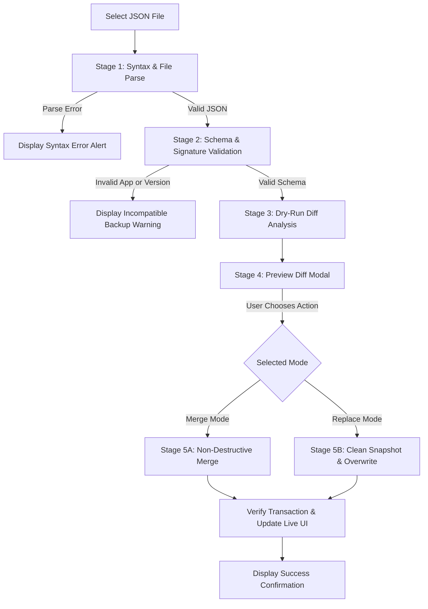

# AK67 — Backup, Portability and Recovery Specification

This document details the architecture, JSON schema, validation rules, conflict resolution mechanisms, and safety safeguards for data backup and restoration in **AK67 — Your Placement Preparation System**.

---

## ⚠️ The Storage Reality & Why Backups Are Mandatory

Because AK67 is a **zero-cost, zero-backend, client-first application**, all user progress is stored exclusively in the browser's **IndexedDB**. 

### Storage Risks Every User Must Understand:
1. **Device Independence**: Devices do **NOT** automatically sync via the cloud. Progress made on a laptop will not automatically appear on a mobile phone unless transferred via a backup file.
2. **Browser Data Clearing**: Using "Clear Browsing Data" or "Clear Cookies and Site Data" in Chrome/Edge/Firefox will wipe IndexedDB.
3. **Private / Incognito Browsing**: Incognito windows use temporary storage that is destroyed as soon as the window closes.
4. **Device Damage or Loss**: If a phone or laptop is lost or damaged without an exported backup, progress cannot be recovered from any server.

**AK67 resolves these risks by providing an effortless, deterministic 1-click JSON export and safe import engine.**

---

## 📄 Backup File Format Specification

- **File Name Pattern**: `AK67_Backup_YYYY-MM-DD_HHmmss.json` (e.g., `AK67_Backup_2026-11-18_160530.json`)
- **MIME Type**: `application/json`
- **Encoding**: UTF-8

### Complete JSON Schema

```json
{
  "appName": "AK67",
  "appVersion": "1.0.0",
  "schemaVersion": 1,
  "exportedAt": "2026-11-18T16:05:30.123Z",
  "summary": {
    "totalProblemsTracked": 67,
    "solvedCount": 24,
    "attemptedCount": 8,
    "totalNotes": 12,
    "mockTestsCount": 3,
    "studySessionsCount": 19,
    "companyProfilesCount": 4
  },
  "data": {
    "problem_progress": [
      {
        "id": "two-sum",
        "topic": "Arrays",
        "difficulty": "Easy",
        "status": "solved",
        "personalNotes": "Used unordered_map for O(n) one-pass solution. Watch out for using the same element twice.",
        "userCode": "vector<int> twoSum(vector<int>& nums, int target) { ... }",
        "bookmarked": true,
        "lastAttemptedAt": "2026-11-17T14:20:00.000Z",
        "solvedAt": "2026-11-17T14:30:00.000Z",
        "revisionCount": 1,
        "intervalDays": 3,
        "easeFactor": 2.5,
        "nextRevisionDate": "2026-11-20"
      }
    ],
    "topic_progress": [],
    "daily_planner": [],
    "mock_tests": [],
    "company_profiles": [],
    "notes": [],
    "study_sessions": [],
    "app_settings": [
      {
        "key": "theme",
        "value": "dark"
      },
      {
        "key": "placement_target_date",
        "value": "2026-09-01"
      }
    ]
  }
}
```

---

## 🛡️ Step-by-Step Restoration Lifecycle

When a user imports a backup file, the system executes a strict multi-stage safety protocol before any database records are altered:



### Stage 1: Syntax & File Parsing
- The file is read via `FileReader` as text.
- Standard `JSON.parse()` with error trapping. Malformed or truncated files are rejected immediately.

### Stage 2: Schema & Signature Validation
The imported object must satisfy:
1. `appName === "AK67"`.
2. `typeof schemaVersion === "number"` and `schemaVersion <= CURRENT_SUPPORTED_SCHEMA_VERSION`.
3. `typeof data === "object"` containing the expected array keys (`problem_progress`, `topic_progress`, etc.).
4. Array elements validate against runtime type guards.

### Stage 3: Dry-Run Diff Analysis
The system queries the current local IndexedDB state and compares it record-by-record against the backup:
- **New Records**: Records present in backup but absent locally.
- **Updated Records**: Records present in both where `backup.updatedAt > local.updatedAt` or local is unattempted while backup is solved.
- **Identical Records**: Records with identical progress.
- **Conflicting Records**: Records modified both locally and in backup.

### Stage 4: Preview Diff Modal
The user is presented with a detailed pre-commit breakdown:
- "This backup from **Nov 18, 2026** contains **24 solved problems**, **12 notes**, and **3 mock tests**."
- "Local database contains **5 solved problems**."
- Clear choice between two restoration strategies:
  1. **Merge (Recommended)**: Combines backup data with existing local data. Preserves local notes if newer; upgrades problem status to `solved` if solved in either dataset.
  2. **Replace (Clean Restore)**: Wipes local IndexedDB and restores exact state of the backup. Requires explicit user confirmation checkbox: *"I understand this replaces my current device progress"*.

### Stage 5: Atomic Transactional Commit
- The write operations run inside a single Dexie transaction (`db.transaction('rw', [...tables], async () => { ... })`).
- If any write fails, the entire transaction is rolled back, leaving the database completely intact.

---

## 🔔 Automated Backup Reminder System

To protect users against unexpected device failures, AK67 implements an intelligent, non-intrusive reminder system:

1. **Trigger Conditions**:
   - `Days Elapsed`: $\ge 3$ days have passed since the last exported backup.
   - `Significant Milestone`: $\ge 5$ new DSA problems solved since the last backup.
2. **Visual Cue**:
   - A subtle warning badge on the "Data & Backup" icon in the navigation header.
   - A friendly banner on the Dashboard: *"You've solved 5 problems since your last backup. Download a quick backup to keep your progress safe."*
   - Direct 1-click download button in the banner.
3. **Dismiss Option**:
   - The user can dismiss the reminder for 48 hours without disabling future alerts.
